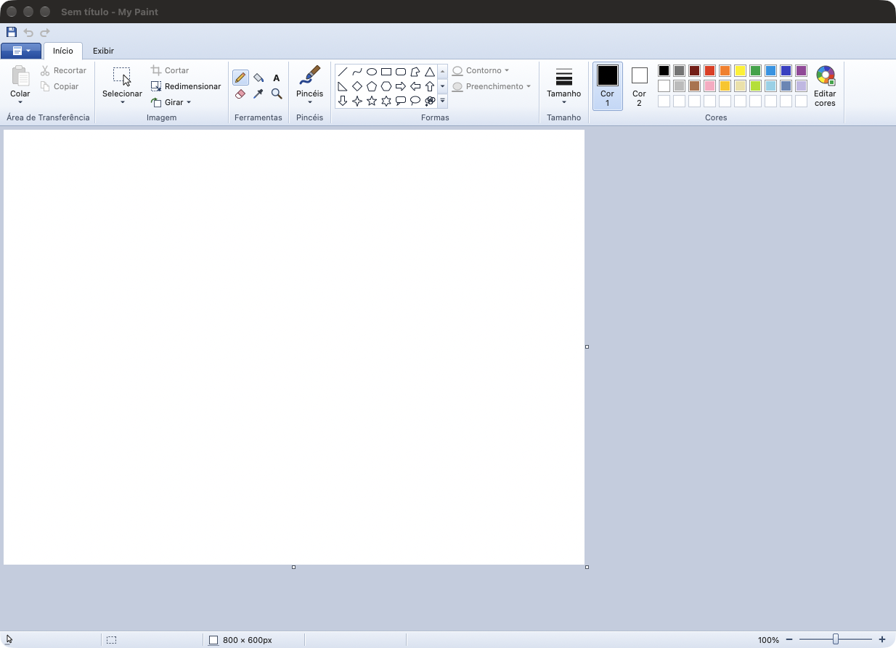

# My Paint

**Português (Brasil)** · [English](docs/readme/en.md) · [Español](docs/readme/es.md) · [Français](docs/readme/fr.md) · [Deutsch](docs/readme/de.md) · [Italiano](docs/readme/it.md) · [日本語](docs/readme/ja.md) · [한국어](docs/readme/ko.md)

Um editor de imagens simples para macOS inspirado no Paint do Windows 7. Abra uma imagem, desenhe com lápis, pincéis, formas e texto, e salve em PNG, JPEG, BMP ou GIF com os atalhos que suas mãos já conhecem.

## Baixar para macOS

- **[Baixar para Apple Silicon (série M)](https://github.com/leoars/my-paint/releases/download/0.1.1/My-Paint-0.1.1-arm64.pkg)**
- **[Baixar para Intel](https://github.com/leoars/my-paint/releases/download/0.1.1/My-Paint-0.1.1-x86_64.pkg)**

Requer macOS 12 ou posterior. [Ver a versão mais recente](https://github.com/leoars/my-paint/releases/latest)



## Por que este projeto existe?

O My Paint nasceu da mesma saudade que deu origem ao My Notepad: a de quem trocou o Windows pelo Mac e sente falta de abrir um editor de imagens que não pede nada além de uma janela, uma faixa de ferramentas e a tela em branco. O projeto recupera esse jeito de trabalhar em Swift e AppKit, sem dependências externas. A barra de título e a barra de menus são do macOS; da faixa de opções para baixo, tudo segue o Paint do Windows 7. Ícones, texturas e textos foram desenhados e escritos do zero.

## No dia a dia

- **Ferramentas:** lápis, borracha, balde, selecionador de cor, lupa e texto. O botão esquerdo pinta com a Cor 1 e o direito com a Cor 2.
- **Pincéis:** pincel, caligráficos 1 e 2, spray, óleo, giz de cera, marcador, lápis natural e aquarela, cada um com seus tamanhos.
- **Formas:** as 23 da galeria, de linhas e curvas a setas, estrelas, balões, coração e raio. Escolha Contorno e Preenchimento (cor sólida ou textura), ajuste pelas alças e clique fora para fixar. Segure `Shift` para manter a proporção ou o ângulo.
- **Seleção:** retangular ou de forma livre, com seleção transparente, mover, duplicar, recortar, copiar e colar entre apps. Cortar, Redimensionar e inclinar, Girar e inverter e Inverter cor valem para a seleção ou para a imagem inteira.
- **Exibir:** zoom de 12,5% a 800%, réguas, linhas de grade, tela inteira, miniatura e barra de status.
- **Imprimir, Propriedades da imagem, Editar cores** (com 10 posições personalizadas na paleta), imagens recentes e **Definir como plano de fundo da área de trabalho**.
- **Tamanho do texto da interface** em quatro níveis, para monitores de resolução alta, na guia Exibir e em **My Paint → Ajustes…**.
- Disponível em português, inglês, espanhol, francês, alemão, italiano, japonês e coreano.


### Atalhos que vale conhecer

Os atalhos com `Ctrl` funcionam como no Windows; os equivalentes com `Cmd` também.

| Teclas | Ação |
| --- | --- |
| `Ctrl+Z` · `Ctrl+Y` | Desfazer e refazer (50 níveis) |
| `Ctrl+A` · `Ctrl+C` · `Ctrl+X` · `Ctrl+V` | Selecionar tudo, copiar, recortar e colar |
| `Ctrl+W` | Redimensionar e inclinar |
| `Ctrl+Shift+X` · `Ctrl+Shift+I` | Cortar e inverter cor |
| `Ctrl++` / `Ctrl+-` | Aumentar ou diminuir a espessura |
| `Ctrl+B` · `Ctrl+I` · `Ctrl+U` | Negrito, itálico e sublinhado no texto |
| `Ctrl+R` · `Ctrl+G` · `F11` | Réguas, linhas de grade e tela inteira |
| `Ctrl+E` · `Ctrl+P` | Propriedades da imagem e imprimir |
| `Shift+F10` | Menu de contexto |

## Compilar e instalar no Mac

Para compilar, use as ferramentas de desenvolvimento da Apple com o compilador Swift. Na raiz do projeto, execute:

```sh
./build.sh
open "My Paint.app"
```

Para rodar os testes automáticos:

```sh
./test.sh
```

Para gerar os dois instaladores, execute o comando abaixo. Em `dist/`, escolha o pacote `arm64` para Apple Silicon ou `x86_64` para Intel. Abra o arquivo `.pkg` para instalar o aplicativo em `/Applications`.

```sh
./package.sh
```

O ícone é desenhado em código por `Tools/icon.swift`; para gerá-lo de novo, execute `swift Tools/icon.swift Resources/MyPaint.icns`.

## Como contribuir

As ferramentas, a faixa de opções e os diálogos ficam em [Swift](Sources), e os testes em [Tests](Tests). As [traduções](Resources) estão em pastas `.lproj`, uma por idioma. Ao relatar um problema, inclua a versão do macOS, a ferramenta usada e, se possível, uma imagem curta que reproduza o caso.

## Licença

O código e a documentação originais são distribuídos sob a [Apache License 2.0](LICENSE). Paint, Windows e Microsoft são marcas da Microsoft Corporation; este projeto não tem relação com ela. Veja [THIRD_PARTY_NOTICES.md](THIRD_PARTY_NOTICES.md).
