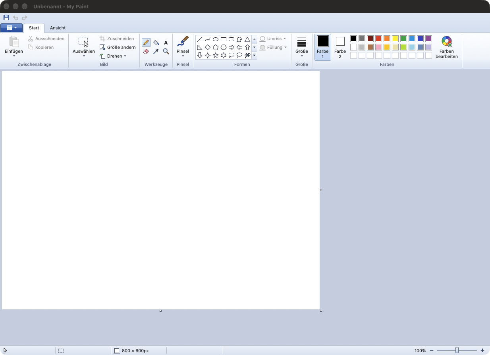

# My Paint

[Português (Brasil)](../../README.md) · [English](en.md) · [Español](es.md) · [Français](fr.md) · **Deutsch** · [Italiano](it.md) · [日本語](ja.md) · [한국어](ko.md)

**My-Suite:** [My Explorer](https://github.com/leoars/my-explorer/blob/main/README.de.md) · [My Notepad](https://github.com/leoars/My-Notepad/blob/main/docs/readme/de.md) · **My Paint**

Ein einfacher Bildeditor für macOS. Öffne ein Bild, zeichne mit Stift, Pinseln, Formen und Text und sichere als PNG, JPEG, BMP oder GIF – mit den Tastenkürzeln, die du schon kennst.

## Download für macOS

- **[Für Apple Silicon (M-Serie) herunterladen](https://github.com/leoars/my-paint/releases/download/1.0.1/My-Paint-1.0.1-arm64.pkg)**
- **[Für Intel herunterladen](https://github.com/leoars/my-paint/releases/download/1.0.1/My-Paint-1.0.1-x86_64.pkg)**

Erfordert macOS 12 oder neuer. [Zur neuesten Version](https://github.com/leoars/my-paint/releases/latest)

Um My Explorer, My Notepad und My Paint auf einmal zu installieren, nutze das [Installationsprogramm der My-Suite](https://github.com/leoars/my-suite/blob/main/docs/readme/en.md).



## Warum gibt es dieses Projekt?

My Paint entstand aus derselben Idee wie My Notepad: ein Bildeditor, der nichts weiter braucht als ein Fenster, ein Menüband mit Werkzeugen und eine leere Zeichenfläche. Das Projekt bietet diese Arbeitsweise mit Swift und AppKit, ohne externe Abhängigkeiten. Symbole, Texturen und Texte wurden von Grund auf neu gezeichnet und geschrieben.

## Funktionen

### Datei und Formate

- **Neu**, **Öffnen …**, **Speichern** und **Speichern unter …**, dazu **Kopie in anderem Format speichern**.
- Öffnet und speichert PNG, JPEG, BMP, GIF und TIFF. Öffnet Bilder aus dem Finder.
- **Zuletzt verwendete Bilder** mit bis zu 9 Dateien, die sich an die Liste anheften lassen.
- **Bildeigenschaften**: Größe, Einheiten (Zoll, Zentimeter oder Pixel), Farbe oder Schwarzweiß, Datum und Größe auf dem Datenträger.
- **Als Schreibtischhintergrund festlegen**: füllen, kacheln oder zentrieren.

### Werkzeuge

- **Stift**, **Radierer**, **Mit Farbe füllen**, **Farbpipette**, **Lupe** und **Text**.
- Die linke Taste malt mit Farbe 1, die rechte mit Farbe 2.
- **Größe** legt die Strichstärke jedes Werkzeugs fest.

### Pinsel

- Neun Pinsel: Pinsel, Kalligrafiepinsel 1 und 2, Airbrush, Ölpinsel, Wachsmalstift, Marker, Natürlicher Bleistift und Aquarellpinsel, jeweils in vier Größen.

### Formen

- Alle 23 Formen der Galerie: Linie, Kurve, Ellipse, Rechteck, abgerundetes Rechteck, Vieleck, Dreiecke, Raute, Fünfeck, Sechseck, Pfeile, Sterne mit vier, fünf und sechs Zacken, Sprechblasen, Herz und Blitz.
- **Umriss** und **Füllung** als Volltonfarbe oder Textur (Wachsmalstift, Marker, Öl, Natürlicher Bleistift und Wasserfarbe).
- Passe die Form an den Griffen an, bevor du sie festlegst. Halte `Shift` gedrückt, um Seitenverhältnis oder Winkel beizubehalten.


### Farben

- **Farbe 1** und **Farbe 2**, mit der Palette aus 20 Farben und 10 Plätzen für eigene Farben.
- **Farben bearbeiten**: 48 Grundfarben, 16 eigene Farben und Einstellung über Farbton, Sättigung und Helligkeit oder über Rot, Grün und Blau.
- Im Schwarzweißmodus verwenden Palette und Zeichnung nur die beiden Farben.

### Auswahl und Zwischenablage

- **Rechteckige Auswahl** und **Freihandauswahl**, **Alles auswählen**, **Auswahl umkehren** und **Transparente Auswahl**.
- Bewegen, duplizieren (beim Ziehen `Strg` halten), an den Griffen strecken oder mit den Pfeiltasten pixelweise verschieben.
- **Ausschneiden**, **Kopieren** und **Einfügen** zwischen Apps sowie **Einfügen aus …**, um eine Datei einzufügen.

### Bild

- **Zuschneiden** auf die Auswahl.
- **Größe ändern und neigen** in Prozent oder Pixeln, mit oder ohne festes Seitenverhältnis.
- **Drehen** um 90° nach rechts oder links und um 180°; vertikal oder horizontal **spiegeln**.
- **Farben umkehren**.
- Das alles gilt für die Auswahl oder das ganze Bild. Auch die Zeichenfläche lässt sich an ihren Griffen in der Größe ändern.

### Text

- Tab **Textwerkzeuge** mit Schriftfamilie und Schriftgröße, fett, kursiv, unterstrichen und durchgestrichen.
- Deckender oder transparenter Hintergrund.
- Unterstützt die Eingabemethoden für Japanisch und Koreanisch.

### Ansicht

- Zoom von 12,5 % bis 800 %, per Tastatur oder mit dem Regler in der Statusleiste.
- **Lineale**, **Gitternetz**, **Statusleiste**, **Vollbild** und **Miniatur**.
- **Textgröße der Oberfläche** in vier Stufen für hochauflösende Displays, im Tab „Ansicht“ und unter **My Paint → Einstellungen …**.

### Drucken

- **Drucken …**, **Papierformat …** (an eine Seitenzahl anpassen und zentrieren) und **Druckvorschau**.

### Oberfläche und Sprachen

- Menüs im Fenster über dem Menüband, zusätzlich zur macOS-Menüleiste.
- Menüband mit den Tabs **Start** und **Ansicht**, das sich minimieren lässt, und Schnellzugriffsleiste mit Speichern, Rückgängig und Wiederholen.
- Rückgängig und Wiederholen über 50 Schritte.
- Verfügbar auf Portugiesisch, Englisch, Spanisch, Französisch, Deutsch, Italienisch, Japanisch und Koreanisch.
- **Nach Updates suchen …** im Menü My Paint und eine Prüfung beim Öffnen, höchstens einmal am Tag, die sich unter **Einstellungen …** ausschalten lässt. Eine neue Version wird nur nach Zustimmung geladen, geprüft (Signatur des Entwicklers und Notarisierung durch Apple) und im macOS-Installationsprogramm geöffnet; My Paint startet danach wieder.

### Tastenkürzel

Kürzel mit `Strg` funktionieren so, wie du sie schon kennst; die Entsprechungen mit `Cmd` ebenfalls.

| Tasten | Aktion |
| --- | --- |
| `Strg+N` · `Strg+O` · `Strg+S` · `F12` | Neu, Öffnen, Speichern und Speichern unter |
| `Strg+Z` · `Strg+Y` | Rückgängig und Wiederholen (50 Schritte) |
| `Strg+A` · `Strg+C` · `Strg+X` · `Strg+V` | Alles auswählen, Kopieren, Ausschneiden und Einfügen |
| `Strg+W` | Größe ändern und neigen |
| `Strg+Shift+X` · `Strg+Shift+I` | Zuschneiden und Farben umkehren |
| `Strg++` / `Strg+-` | Strichstärke erhöhen oder verringern |
| `Strg+Page Up` / `Strg+Page Down` | Vergrößern oder verkleinern |
| `Strg+B` · `Strg+I` · `Strg+U` | Fett, kursiv und unterstrichen im Text |
| `Strg+R` · `Strg+G` · `F11` | Lineale, Gitternetz und Vollbild |
| `Strg+E` · `Strg+P` | Bildeigenschaften und Drucken |
| `Strg+F1` | Menüband minimieren |
| `Shift+F10` | Kontextmenü |
| `Esc` · `Enter` · `Delete` | Aktion abbrechen, Form festlegen und Auswahl löschen |

## Teil der My-Suite

My Paint gehört zur My-Suite: drei einfache, unkomplizierte Apps für macOS, mit den gewohnten Menüs und Tastenkürzeln.

- **My Paint** (dieses Repository): ein einfacher Bildeditor.
- **[My Explorer](https://github.com/leoars/my-explorer/blob/main/README.de.md)**: ein Dateimanager mit Ordnerbaum, Tabs und einer Befehlsleiste. Ist My Paint installiert, bietet das Kontextmenü von My Explorer für Bilder **Mit My Paint bearbeiten** an.
- **[My Notepad](https://github.com/leoars/My-Notepad/blob/main/docs/readme/de.md)**: ein einfacher Texteditor.

## Auf dem Mac kompilieren und installieren

Zum Kompilieren brauchst du Apples Entwicklerwerkzeuge mit dem Swift-Compiler. Führe im Projektordner Folgendes aus:

```sh
./build.sh
open "My Paint.app"
```

So startest du die automatischen Tests:

```sh
./test.sh
```

Mit dem folgenden Befehl erzeugst du beide Installationspakete. Wähle in `dist/` das Paket `arm64` für Apple Silicon oder `x86_64` für Intel. Öffne die `.pkg`-Datei, um die App in `/Applications` zu installieren.

```sh
./package.sh
```

Das Symbol wird von `Tools/icon.swift` im Code gezeichnet; mit `swift Tools/icon.swift Resources/MyPaint.icns` erzeugst du es neu.

## Mitwirken

Werkzeuge, Menüband und Dialoge sind in [Swift](../../Sources) geschrieben, die Tests liegen in [Tests](../../Tests). Die [Übersetzungen](../../Resources) liegen in `.lproj`-Ordnern, einer pro Sprache. Nenne bei einer Fehlermeldung bitte die macOS-Version, das verwendete Werkzeug und, wenn möglich, ein kleines Bild, das den Fall reproduziert.

## Lizenz

Der ursprüngliche Code und die Dokumentation stehen unter der [Apache License 2.0](../../LICENSE). Siehe [THIRD_PARTY_NOTICES.md](../../THIRD_PARTY_NOTICES.md).
