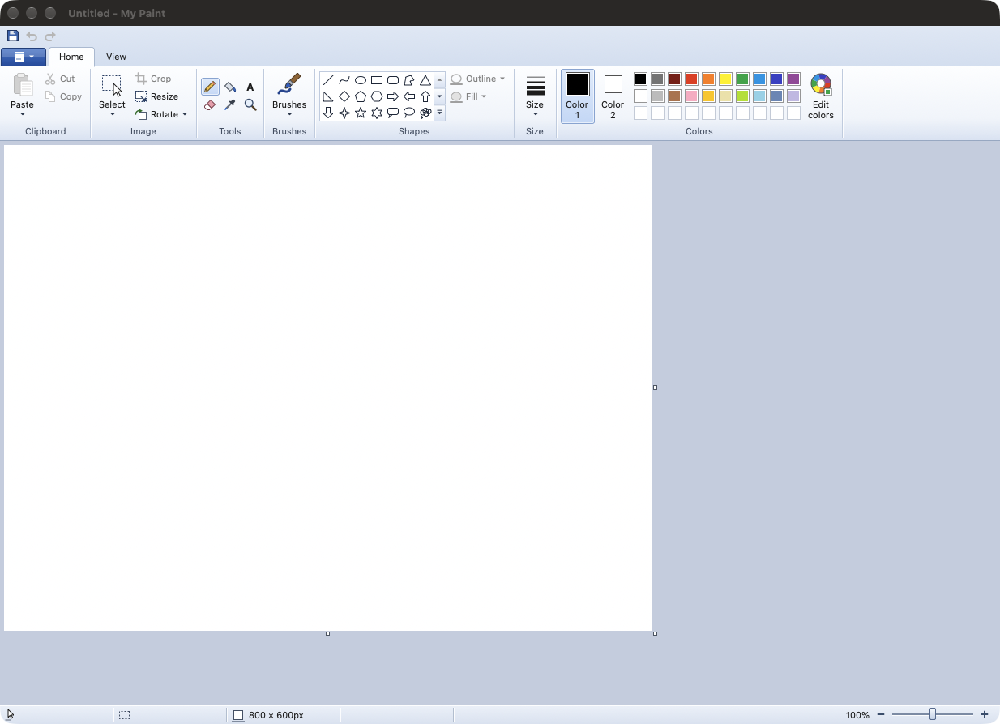

# My Paint

[Português (Brasil)](../../README.md) · **English** · [Español](es.md) · [Français](fr.md) · [Deutsch](de.md) · [Italiano](it.md) · [日本語](ja.md) · [한국어](ko.md)

A simple image editor for macOS inspired by Windows 7 Paint. Open a picture, draw with the pencil, brushes, shapes and text, and save as PNG, JPEG, BMP or GIF with the shortcuts you remember.

## Download for macOS

- **[Download for Apple Silicon (M-series)](https://github.com/leoars/my-paint/releases/download/0.1.0/My-Paint-0.1.0-arm64.pkg)**
- **[Download for Intel](https://github.com/leoars/my-paint/releases/download/0.1.0/My-Paint-0.1.0-x86_64.pkg)**

Requires macOS 12 or later. [View the latest release](https://github.com/leoars/my-paint/releases/latest)



## Why My Paint?

My Paint comes from the same longing behind My Notepad. After moving from Windows to the Mac, we missed an image editor that asks for nothing but a window, a ribbon of tools and a blank canvas. The project brings that way of working back in Swift and AppKit, with no external dependencies. The title bar and the menu bar belong to macOS; from the ribbon down, everything follows Windows 7 Paint. Icons, textures and text were drawn and written from scratch.

## Everyday editing

- **Tools:** Pencil, Eraser, Fill with Color, Color Picker, Magnifier and Text. The left button paints with Color 1 and the right button with Color 2.
- **Brushes:** Brush, Calligraphy brushes 1 and 2, Airbrush, Oil brush, Crayon, Marker, Natural pencil and Watercolor brush, each with its own sizes.
- **Shapes:** all 23 in the gallery, from lines and curves to arrows, stars, callouts, a heart and a lightning bolt. Choose Outline and Fill (solid color or texture), adjust with the handles and click outside to commit. Hold `Shift` to keep the proportions or the angle.
- **Selection:** rectangular or free-form, with transparent selection, move, duplicate, cut, copy and paste between apps. Crop, Resize and Skew, Rotate or flip, and Invert color apply to the selection or to the whole picture.
- **View:** zoom from 12.5% to 800%, rulers, gridlines, full screen, thumbnail and status bar.
- **Print, Image Properties, Edit Colors** (with 10 custom slots in the palette), recent pictures and **Set as desktop background**.
- **Interface text size** in four levels for high-resolution displays, on the View tab and in **My Paint → Settings…**.
- Available in Portuguese, English, Spanish, French, German, Italian, Japanese and Korean.


### Keyboard shortcuts

Shortcuts with `Ctrl` work as they do on Windows; the `Cmd` equivalents work too.

| Keys | Action |
| --- | --- |
| `Ctrl+Z` · `Ctrl+Y` | Undo and redo (50 levels) |
| `Ctrl+A` · `Ctrl+C` · `Ctrl+X` · `Ctrl+V` | Select all, copy, cut and paste |
| `Ctrl+W` | Resize and Skew |
| `Ctrl+Shift+X` · `Ctrl+Shift+I` | Crop and invert color |
| `Ctrl++` / `Ctrl+-` | Increase or decrease the line width |
| `Ctrl+B` · `Ctrl+I` · `Ctrl+U` | Bold, italic and underline in text |
| `Ctrl+R` · `Ctrl+G` · `F11` | Rulers, gridlines and full screen |
| `Ctrl+E` · `Ctrl+P` | Image properties and print |
| `Shift+F10` | Context menu |

## Build and install on Mac

To build on your Mac, you need Apple’s developer tools with the Swift compiler. From the project root, run:

```sh
./build.sh
open "My Paint.app"
```

To run the automated tests:

```sh
./test.sh
```

To build both installers, run the command below. In `dist/`, choose the `arm64` package for Apple Silicon or `x86_64` for Intel. Open the `.pkg` to install the app in `/Applications`.

```sh
./package.sh
```

The icon is drawn in code by `Tools/icon.swift`; to regenerate it, run `swift Tools/icon.swift Resources/MyPaint.icns`.

## Contributing

The tools, the ribbon and the dialogs are written in [Swift](../../Sources), with the tests in [Tests](../../Tests). The [translations](../../Resources) live in one `.lproj` directory per language. When reporting a problem, include your macOS version, the tool you were using and, if possible, a small picture that reproduces it.

## License

Original code and documentation are distributed under the [Apache License 2.0](../../LICENSE). Paint, Windows and Microsoft are trademarks of Microsoft Corporation; this project is not affiliated with it. See [THIRD_PARTY_NOTICES.md](../../THIRD_PARTY_NOTICES.md).
