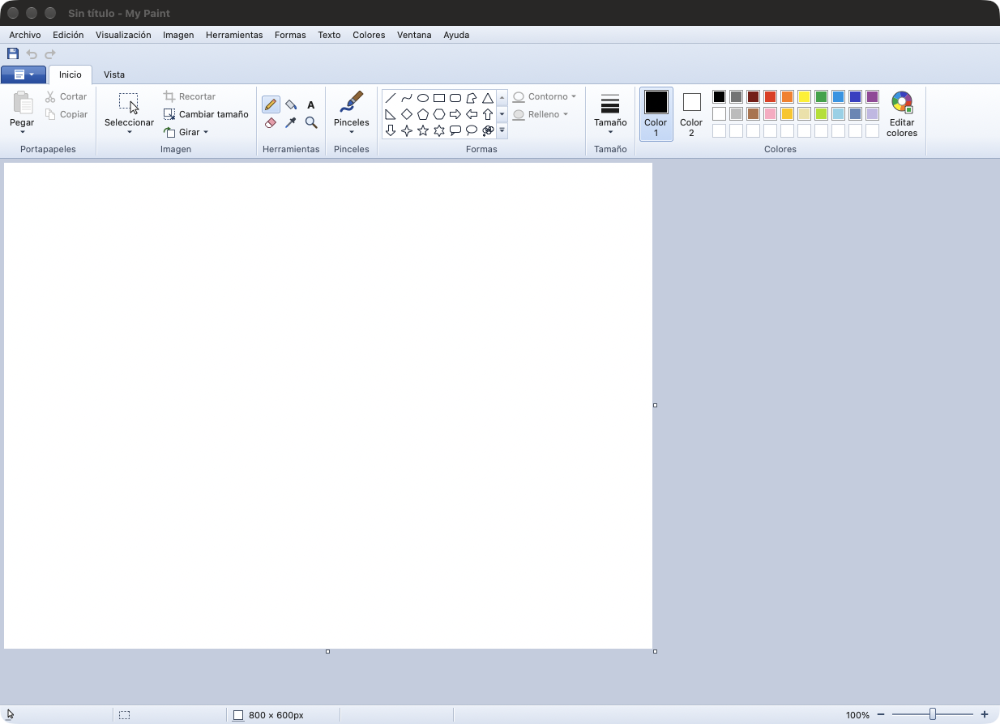

# My Paint

[Português (Brasil)](../../README.md) · [English](en.md) · **Español** · [Français](fr.md) · [Deutsch](de.md) · [Italiano](it.md) · [日本語](ja.md) · [한국어](ko.md)

**Suite My:** [My Explorer](https://github.com/leoars/my-explorer/blob/main/README.es.md) · [My Notepad](https://github.com/leoars/My-Notepad/blob/main/docs/readme/es.md) · **My Paint**

Un editor de imágenes sencillo para macOS. Abre una imagen, dibuja con el lápiz, los pinceles, las formas y el texto, y guarda en PNG, JPEG, BMP o GIF con los atajos que ya conoces.

## Descargar para macOS

- **[Descargar para Apple Silicon (serie M)](https://github.com/leoars/my-paint/releases/download/1.0/My-Paint-1.0-arm64.pkg)**
- **[Descargar para Intel](https://github.com/leoars/my-paint/releases/download/1.0/My-Paint-1.0-x86_64.pkg)**

Requiere macOS 12 o posterior. [Ver la última versión](https://github.com/leoars/my-paint/releases/latest)



## ¿Por qué existe este proyecto?

My Paint nace de la misma idea que My Notepad: un editor de imágenes que solo pide una ventana, una cinta de herramientas y un lienzo en blanco. El proyecto ofrece esa forma de trabajar en Swift y AppKit, sin dependencias externas. Los iconos, las texturas y los textos se dibujaron y escribieron desde cero.

## Funciones

### Archivo y formatos

- **Nuevo**, **Abrir…**, **Guardar** y **Guardar como…**, con **Guardar una copia en otro formato**.
- Abre y guarda PNG, JPEG, BMP, GIF y TIFF. Abre imágenes desde el Finder.
- **Imágenes recientes** con hasta 9 archivos, que se pueden anclar a la lista.
- **Propiedades de la imagen**: tamaño, unidades (pulgadas, centímetros o píxeles), color o blanco y negro, fecha y tamaño en disco.
- **Establecer como fondo de escritorio**: rellenar, mosaico o centrar.

### Herramientas

- **Lápiz**, **Borrador**, **Rellenar con color**, **Selector de color**, **Lupa** y **Texto**.
- El botón izquierdo pinta con Color 1 y el derecho con Color 2.
- **Tamaño** define el grosor de cada herramienta.

### Pinceles

- Nueve pinceles: Pincel, Pinceles caligráficos 1 y 2, Aerógrafo, Pincel de óleo, Crayón, Marcador, Lápiz natural y Pincel de acuarela, cada uno con cuatro tamaños.

### Formas

- Las 23 formas de la galería: línea, curva, óvalo, rectángulo, rectángulo redondeado, polígono, triángulos, rombo, pentágono, hexágono, flechas, estrellas de cuatro, cinco y seis puntas, bocadillos, corazón y rayo.
- **Contorno** y **Relleno** en color sólido o con textura (crayón, marcador, óleo, lápiz natural y acuarela).
- Ajusta la forma con los controladores antes de fijarla. Mantén pulsada `Shift` para conservar la proporción o el ángulo.


### Colores

- **Color 1** y **Color 2**, con la paleta de 20 colores y 10 posiciones para colores personalizados.
- **Editar colores**: 48 colores básicos, 16 personalizados y ajuste por matiz, saturación y luminosidad o por rojo, verde y azul.
- En el modo blanco y negro, la paleta y el dibujo usan solo los dos colores.

### Selección y portapapeles

- **Selección rectangular** y **Selección libre**, **Seleccionar todo**, **Invertir selección** y **Selección transparente**.
- Mueve, duplica (arrastrando con `Ctrl`), estira con los controladores o desplaza un píxel cada vez con las flechas.
- **Cortar**, **Copiar** y **Pegar** entre aplicaciones, y **Pegar desde…** para traer un archivo.

### Imagen

- **Recortar** a la selección.
- **Cambiar tamaño e inclinar** por porcentaje o píxeles, manteniendo o no la relación de aspecto.
- **Girar** 90° a la derecha o a la izquierda y 180°; **Voltear** vertical u horizontalmente.
- **Invertir colores**.
- Se aplican a la selección o a toda la imagen. El lienzo también se puede redimensionar con sus controladores.

### Texto

- Pestaña **Herramientas de texto** con familia y tamaño de fuente, negrita, cursiva, subrayado y tachado.
- Fondo opaco o transparente.
- Admite los métodos de entrada del japonés y del coreano.

### Vista

- Zoom del 12,5 % al 800 %, desde el teclado o con el control de la barra de estado.
- **Reglas**, **Cuadrícula**, **Barra de estado**, **Pantalla completa** y **Miniatura**.
- **Tamaño del texto de la interfaz** en cuatro niveles, para pantallas de alta resolución, en la pestaña Vista y en **My Paint → Ajustes…**.

### Imprimir

- **Imprimir…**, **Ajustar página…** (ajustar a un número de páginas y centrar) y **Vista previa de impresión**.

### Interfaz e idiomas

- Menús dentro de la ventana, sobre la cinta de opciones, además de la barra de menús de macOS.
- Cinta de opciones con las pestañas **Inicio** y **Vista**, que se puede minimizar, y barra de acceso rápido con Guardar, Deshacer y Rehacer.
- Deshacer y rehacer con 50 niveles.
- Disponible en portugués, inglés, español, francés, alemán, italiano, japonés y coreano.

### Atajos

Los atajos con `Ctrl` funcionan como ya los conoces; los equivalentes con `Cmd`, también.

| Teclas | Acción |
| --- | --- |
| `Ctrl+N` · `Ctrl+O` · `Ctrl+S` · `F12` | Nuevo, abrir, guardar y guardar como |
| `Ctrl+Z` · `Ctrl+Y` | Deshacer y rehacer (50 niveles) |
| `Ctrl+A` · `Ctrl+C` · `Ctrl+X` · `Ctrl+V` | Seleccionar todo, copiar, cortar y pegar |
| `Ctrl+W` | Cambiar tamaño e inclinar |
| `Ctrl+Shift+X` · `Ctrl+Shift+I` | Recortar e invertir colores |
| `Ctrl++` / `Ctrl+-` | Aumentar o reducir el grosor |
| `Ctrl+Page Up` / `Ctrl+Page Down` | Acercar o alejar el zoom |
| `Ctrl+B` · `Ctrl+I` · `Ctrl+U` | Negrita, cursiva y subrayado en el texto |
| `Ctrl+R` · `Ctrl+G` · `F11` | Reglas, cuadrícula y pantalla completa |
| `Ctrl+E` · `Ctrl+P` | Propiedades de la imagen e imprimir |
| `Ctrl+F1` | Minimizar la cinta de opciones |
| `Shift+F10` | Menú contextual |
| `Esc` · `Enter` · `Delete` | Cancelar la acción, fijar la forma y eliminar la selección |

## Parte de la suite My

My Paint forma parte de la suite My: tres aplicaciones para macOS sencillas y directas, con los menús y los atajos de siempre.

- **My Paint** (este repositorio): editor de imágenes sencillo.
- **[My Explorer](https://github.com/leoars/my-explorer/blob/main/README.es.md)**: gestor de archivos con árbol de carpetas, pestañas y barra de comandos. Con My Paint instalado, el menú contextual de My Explorer incorpora **Editar con My Paint** para las imágenes.
- **[My Notepad](https://github.com/leoars/My-Notepad/blob/main/docs/readme/es.md)**: editor de texto sencillo.

## Compilar e instalar en el Mac

Para compilar, usa las herramientas de desarrollo de Apple con el compilador de Swift. En la raíz del proyecto, ejecuta:

```sh
./build.sh
open "My Paint.app"
```

Para ejecutar las pruebas automáticas:

```sh
./test.sh
```

Para generar los dos instaladores, ejecuta el comando siguiente. En `dist/`, elige el paquete `arm64` para Apple Silicon o `x86_64` para Intel. Abre el archivo `.pkg` para instalar la aplicación en `/Applications`.

```sh
./package.sh
```

El icono se dibuja por código en `Tools/icon.swift`; para generarlo de nuevo, ejecuta `swift Tools/icon.swift Resources/MyPaint.icns`.

## Cómo contribuir

Las herramientas, la cinta de opciones y los cuadros de diálogo están en [Swift](../../Sources), y las pruebas en [Tests](../../Tests). Las [traducciones](../../Resources) están en carpetas `.lproj`, una por idioma. Al informar de un problema, incluye la versión de macOS, la herramienta que usabas y, si es posible, una imagen pequeña que lo reproduzca.

## Licencia

El código y la documentación originales se distribuyen bajo la [Apache License 2.0](../../LICENSE). Consulta [THIRD_PARTY_NOTICES.md](../../THIRD_PARTY_NOTICES.md).
