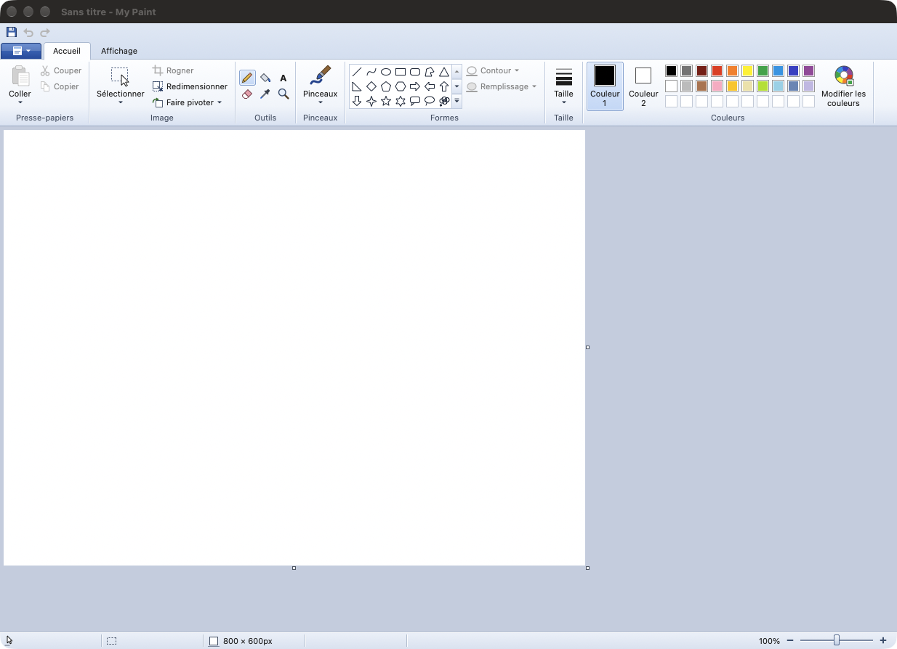

# My Paint

[Português (Brasil)](../../README.md) · [English](en.md) · [Español](es.md) · **Français** · [Deutsch](de.md) · [Italiano](it.md) · [日本語](ja.md) · [한국어](ko.md)

Un éditeur d’images simple pour macOS, inspiré du Paint de Windows 7. Ouvrez une image, dessinez avec le crayon, les pinceaux, les formes et le texte, puis enregistrez en PNG, JPEG, BMP ou GIF avec les raccourcis que vous connaissez déjà.

## Télécharger pour macOS

- **[Télécharger pour Apple Silicon (série M)](https://github.com/leoars/my-paint/releases/download/0.1.0/My-Paint-0.1.0-arm64.pkg)**
- **[Télécharger pour Intel](https://github.com/leoars/my-paint/releases/download/0.1.0/My-Paint-0.1.0-x86_64.pkg)**

Nécessite macOS 12 ou une version ultérieure. [Voir la dernière version](https://github.com/leoars/my-paint/releases/latest)



## Pourquoi ce projet ?

My Paint est né de la même nostalgie que My Notepad. En passant de Windows au Mac, il nous manquait un éditeur d’images qui ne demande rien d’autre qu’une fenêtre, un ruban d’outils et une zone de dessin vide. Le projet retrouve cette façon de travailler en Swift et AppKit, sans dépendance externe. La barre de titre et la barre des menus sont celles de macOS ; à partir du ruban, tout suit le Paint de Windows 7. Les icônes, les textures et les textes ont été dessinés et rédigés de zéro.

## Au quotidien

- **Outils :** Crayon, Gomme, Remplir avec la couleur, Pipette, Loupe et Texte. Le bouton gauche peint avec Couleur 1 et le bouton droit avec Couleur 2.
- **Pinceaux :** Pinceau, Pinceaux calligraphiques 1 et 2, Aérographe, Pinceau à huile, Pastel, Marqueur, Crayon naturel et Pinceau aquarelle, chacun avec ses tailles.
- **Formes :** les 23 de la galerie, des lignes et courbes aux flèches, étoiles, bulles, cœur et éclair. Choisissez Contour et Remplissage (couleur unie ou texture), ajustez avec les poignées et cliquez à l’extérieur pour valider. Maintenez `Shift` pour conserver les proportions ou l’angle.
- **Sélection :** rectangulaire ou de forme libre, avec sélection transparente, déplacement, duplication, couper, copier et coller entre applications. Rogner, Redimensionner et incliner, Faire pivoter ou retourner et Inverser les couleurs s’appliquent à la sélection ou à l’image entière.
- **Affichage :** zoom de 12,5 % à 800 %, règles, quadrillage, plein écran, miniature et barre d’état.
- **Imprimer, Propriétés de l’image, Modifier les couleurs** (avec 10 emplacements personnalisés dans la palette), images récentes et **Définir comme fond d’écran**.
- **Taille du texte de l’interface** sur quatre niveaux, pour les écrans haute résolution, dans l’onglet Affichage et dans **My Paint → Réglages…**.
- Disponible en portugais, anglais, espagnol, français, allemand, italien, japonais et coréen.


### Raccourcis utiles

Les raccourcis avec `Ctrl` fonctionnent comme sous Windows ; leurs équivalents avec `Cmd` aussi.

| Touches | Action |
| --- | --- |
| `Ctrl+Z` · `Ctrl+Y` | Annuler et rétablir (50 niveaux) |
| `Ctrl+A` · `Ctrl+C` · `Ctrl+X` · `Ctrl+V` | Tout sélectionner, copier, couper et coller |
| `Ctrl+W` | Redimensionner et incliner |
| `Ctrl+Shift+X` · `Ctrl+Shift+I` | Rogner et inverser les couleurs |
| `Ctrl++` / `Ctrl+-` | Augmenter ou réduire l’épaisseur |
| `Ctrl+B` · `Ctrl+I` · `Ctrl+U` | Gras, italique et souligné dans le texte |
| `Ctrl+R` · `Ctrl+G` · `F11` | Règles, quadrillage et plein écran |
| `Ctrl+E` · `Ctrl+P` | Propriétés de l’image et imprimer |
| `Shift+F10` | Menu contextuel |

## Compiler et installer sur Mac

Pour compiler, utilisez les outils de développement d’Apple avec le compilateur Swift. À la racine du projet, exécutez :

```sh
./build.sh
open "My Paint.app"
```

Pour lancer les tests automatiques :

```sh
./test.sh
```

Pour générer les deux programmes d’installation, exécutez la commande ci-dessous. Dans `dist/`, choisissez le paquet `arm64` pour Apple Silicon ou `x86_64` pour Intel. Ouvrez le fichier `.pkg` pour installer l’application dans `/Applications`.

```sh
./package.sh
```

L’icône est dessinée par le code de `Tools/icon.swift` ; pour la régénérer, exécutez `swift Tools/icon.swift Resources/MyPaint.icns`.

## Contribuer

Les outils, le ruban et les boîtes de dialogue sont écrits en [Swift](../../Sources), et les tests se trouvent dans [Tests](../../Tests). Les [traductions](../../Resources) sont réparties dans des dossiers `.lproj`, un par langue. Pour signaler un problème, indiquez la version de macOS, l’outil utilisé et, si possible, une petite image qui le reproduit.

## Licence

Le code et la documentation d’origine sont distribués sous la [licence Apache 2.0](../../LICENSE). Paint, Windows et Microsoft sont des marques de Microsoft Corporation ; ce projet n’a aucun lien avec elle. Voir [THIRD_PARTY_NOTICES.md](../../THIRD_PARTY_NOTICES.md).
