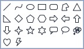

# My Paint

[Português (Brasil)](../../README.md) · [English](en.md) · [Español](es.md) · **Français** · [Deutsch](de.md) · [Italiano](it.md) · [日本語](ja.md) · [한국어](ko.md)

**Suite My:** [My Explorer](https://github.com/leoars/my-explorer/blob/main/README.fr.md) · [My Notepad](https://github.com/leoars/My-Notepad/blob/main/docs/readme/fr.md) · **My Paint**

Un éditeur d’images simple pour macOS. Ouvrez une image, dessinez avec le crayon, les pinceaux, les formes et le texte, puis enregistrez en PNG, JPEG, BMP ou GIF avec les raccourcis que vous connaissez déjà.

## Télécharger pour macOS

- **[Télécharger pour Apple Silicon (série M)](https://github.com/leoars/my-paint/releases/download/1.0.1/My-Paint-1.0.1-arm64.pkg)**
- **[Télécharger pour Intel](https://github.com/leoars/my-paint/releases/download/1.0.1/My-Paint-1.0.1-x86_64.pkg)**

Nécessite macOS 12 ou une version ultérieure. [Voir la dernière version](https://github.com/leoars/my-paint/releases/latest)

Pour installer My Explorer, My Notepad et My Paint en une seule fois, utilisez le [programme d’installation de la suite My](https://github.com/leoars/my-suite/blob/main/docs/readme/en.md).


## Pourquoi ce projet ?

My Paint est né de la même idée que My Notepad : un éditeur d’images qui ne demande rien d’autre qu’une fenêtre, un ruban d’outils et une zone de dessin vide. Le projet propose cette façon de travailler en Swift et AppKit, sans dépendance externe. Les icônes, les textures et les textes ont été dessinés et rédigés de zéro.

## Fonctionnalités

### Fichier et formats

- **Nouveau**, **Ouvrir…**, **Enregistrer** et **Enregistrer sous…**, avec **Enregistrer une copie dans un autre format**.
- Ouvre et enregistre les formats PNG, JPEG, BMP, GIF et TIFF. Ouvre les images depuis le Finder.
- **Images récentes** avec jusqu’à 9 fichiers, que l’on peut épingler à la liste.
- **Propriétés de l’image** : taille, unités (pouces, centimètres ou pixels), couleur ou noir et blanc, date et taille sur le disque.
- **Définir comme fond d’écran** : remplir, mosaïque ou centrer.

### Outils

- **Crayon**, **Gomme**, **Remplir avec la couleur**, **Pipette**, **Loupe** et **Texte**.
- Le bouton gauche peint avec Couleur 1 et le bouton droit avec Couleur 2.
- **Taille** règle l’épaisseur de chaque outil.

### Pinceaux

- Neuf pinceaux : Pinceau, Pinceaux calligraphiques 1 et 2, Aérographe, Pinceau à huile, Pastel, Marqueur, Crayon naturel et Pinceau aquarelle, chacun en quatre tailles.

### Formes

- Les 23 formes de la galerie : ligne, courbe, ovale, rectangle, rectangle arrondi, polygone, triangles, losange, pentagone, hexagone, flèches, étoiles à quatre, cinq et six branches, bulles, cœur et éclair.
- **Contour** et **Remplissage** en couleur unie ou en texture (pastel, marqueur, huile, crayon naturel et aquarelle).
- Ajustez la forme avec les poignées avant de la valider. Maintenez `Shift` pour conserver les proportions ou l’angle.



### Couleurs

- **Couleur 1** et **Couleur 2**, avec la palette de 20 couleurs et 10 emplacements pour les couleurs personnalisées.
- **Modifier les couleurs** : 48 couleurs de base, 16 couleurs personnalisées et réglage par teinte, saturation et luminosité ou par rouge, vert et bleu.
- En mode noir et blanc, la palette et le dessin n’utilisent que les deux couleurs.

### Sélection et presse-papiers

- **Sélection rectangulaire** et **Sélection libre**, **Tout sélectionner**, **Inverser la sélection** et **Sélection transparente**.
- Déplacez, dupliquez (en faisant glisser avec `Ctrl`), étirez avec les poignées ou décalez d’un pixel à la fois avec les flèches.
- **Couper**, **Copier** et **Coller** entre applications, et **Coller depuis…** pour importer un fichier.

### Image

- **Rogner** selon la sélection.
- **Redimensionner et incliner** en pourcentage ou en pixels, en conservant ou non les proportions.
- **Faire pivoter** de 90° à droite ou à gauche et de 180° ; **Retourner** verticalement ou horizontalement.
- **Inverser les couleurs**.
- Ces commandes s’appliquent à la sélection ou à l’image entière. La zone de dessin se redimensionne aussi avec ses poignées.

### Texte

- Onglet **Outils de texte** avec famille et taille de police, gras, italique, souligné et barré.
- Arrière-plan opaque ou transparent.
- Compatible avec les méthodes de saisie du japonais et du coréen.

### Affichage

- Zoom de 12,5 % à 800 %, au clavier ou avec le curseur de la barre d’état.
- **Règles**, **Quadrillage**, **Barre d’état**, **Plein écran** et **Miniature**.
- **Taille du texte de l’interface** sur quatre niveaux, pour les écrans haute résolution, dans l’onglet Affichage et dans **My Paint → Réglages…**.

### Imprimer

- **Imprimer…**, **Format d’impression…** (ajuster à un nombre de pages et centrer) et **Aperçu avant impression**.

### Interface et langues

- Menus dans la fenêtre, au-dessus du ruban, en plus de la barre des menus de macOS.
- Ruban avec les onglets **Accueil** et **Affichage**, que l’on peut réduire, et barre d’accès rapide avec Enregistrer, Annuler et Rétablir.
- Annulation et rétablissement sur 50 niveaux.
- Disponible en portugais, anglais, espagnol, français, allemand, italien, japonais et coréen.
- **Rechercher les mises à jour…** dans le menu My Paint, et une vérification à l’ouverture, au plus une fois par jour, que vous pouvez désactiver dans **Réglages…**. La nouvelle version n’est téléchargée qu’avec votre accord, elle est vérifiée (signature du développeur et notarisation d’Apple) et s’ouvre dans le programme d’installation de macOS ; My Paint se rouvre à la fin de l’installation.

### Raccourcis

Les raccourcis avec `Ctrl` fonctionnent comme vous en avez l’habitude ; leurs équivalents avec `Cmd` aussi.

| Touches | Action |
| --- | --- |
| `Ctrl+N` · `Ctrl+O` · `Ctrl+S` · `F12` | Nouveau, ouvrir, enregistrer et enregistrer sous |
| `Ctrl+Z` · `Ctrl+Y` | Annuler et rétablir (50 niveaux) |
| `Ctrl+A` · `Ctrl+C` · `Ctrl+X` · `Ctrl+V` | Tout sélectionner, copier, couper et coller |
| `Ctrl+W` | Redimensionner et incliner |
| `Ctrl+Shift+X` · `Ctrl+Shift+I` | Rogner et inverser les couleurs |
| `Ctrl++` / `Ctrl+-` | Augmenter ou réduire l’épaisseur |
| `Ctrl+Page Up` / `Ctrl+Page Down` | Zoom avant ou arrière |
| `Ctrl+B` · `Ctrl+I` · `Ctrl+U` | Gras, italique et souligné dans le texte |
| `Ctrl+R` · `Ctrl+G` · `F11` | Règles, quadrillage et plein écran |
| `Ctrl+E` · `Ctrl+P` | Propriétés de l’image et imprimer |
| `Ctrl+F1` | Réduire le ruban |
| `Shift+F10` | Menu contextuel |
| `Esc` · `Enter` · `Delete` | Annuler l’action, valider la forme et supprimer la sélection |

## Un élément de la suite My

My Paint fait partie de la suite My : trois applications pour macOS simples et directes, avec les menus et les raccourcis de toujours.

- **My Paint** (ce dépôt) : éditeur d’images simple.
- **[My Explorer](https://github.com/leoars/my-explorer/blob/main/README.fr.md)** : gestionnaire de fichiers avec arborescence des dossiers, onglets et barre de commandes. Une fois My Paint installé, le menu contextuel de My Explorer propose **Modifier avec My Paint** pour les images.
- **[My Notepad](https://github.com/leoars/My-Notepad/blob/main/docs/readme/fr.md)** : éditeur de texte simple.

## Compiler et installer sur Mac

Pour compiler, utilisez les outils de développement d’Apple avec le compilateur Swift. À la racine du projet, exécutez :

```sh
./build.sh
open "My Paint.app"
```

Pour lancer les tests automatiques :

```sh
./test.sh
```

Pour générer les deux programmes d’installation, exécutez la commande ci-dessous. Dans `dist/`, choisissez le paquet `arm64` pour Apple Silicon ou `x86_64` pour Intel. Ouvrez le fichier `.pkg` pour installer l’application dans `/Applications`.

```sh
./package.sh
```

L’icône est dessinée par le code de `Tools/icon.swift` ; pour la régénérer, exécutez `swift Tools/icon.swift Resources/MyPaint.icns`.

## Contribuer

Les outils, le ruban et les boîtes de dialogue sont écrits en [Swift](../../Sources), et les tests se trouvent dans [Tests](../../Tests). Les [traductions](../../Resources) sont réparties dans des dossiers `.lproj`, un par langue. Pour signaler un problème, indiquez la version de macOS, l’outil utilisé et, si possible, une petite image qui le reproduit.

## Licence

Le code et la documentation d’origine sont distribués sous la [licence Apache 2.0](../../LICENSE). Voir [THIRD_PARTY_NOTICES.md](../../THIRD_PARTY_NOTICES.md).
