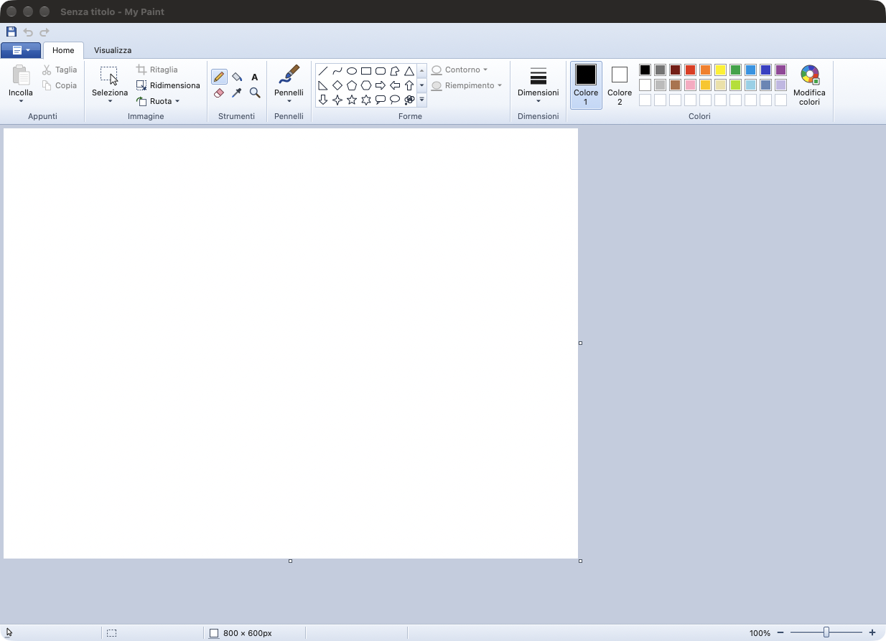

# My Paint

[Português (Brasil)](../../README.md) · [English](en.md) · [Español](es.md) · [Français](fr.md) · [Deutsch](de.md) · **Italiano** · [日本語](ja.md) · [한국어](ko.md)

Un semplice editor di immagini per macOS ispirato al Paint di Windows 7. Apri un’immagine, disegna con matita, pennelli, forme e testo e salva in PNG, JPEG, BMP o GIF con le scorciatoie che conosci già.

## Scarica per macOS

- **[Scarica per Apple Silicon (serie M)](https://github.com/leoars/my-paint/releases/download/0.1.1/My-Paint-0.1.1-arm64.pkg)**
- **[Scarica per Intel](https://github.com/leoars/my-paint/releases/download/0.1.1/My-Paint-0.1.1-x86_64.pkg)**

Richiede macOS 12 o successivo. [Vedi la versione più recente](https://github.com/leoars/my-paint/releases/latest)



## Perché esiste questo progetto?

My Paint nasce dalla stessa nostalgia che ha dato origine a My Notepad. Passando da Windows al Mac, ci mancava un editor di immagini che non chiede altro che una finestra, una barra multifunzione di strumenti e un’area di disegno vuota. Il progetto ritrova quel modo di lavorare in Swift e AppKit, senza dipendenze esterne. La barra del titolo e la barra dei menu sono quelle di macOS; dalla barra multifunzione in giù, tutto segue il Paint di Windows 7. Icone, texture e testi sono stati disegnati e scritti da zero.

## Nell’uso quotidiano

- **Strumenti:** Matita, Gomma, Riempi con colore, Selettore colore, Lente e Testo. Il pulsante sinistro dipinge con Colore 1 e il destro con Colore 2.
- **Pennelli:** Pennello, Pennelli calligrafici 1 e 2, Aerografo, Pennello a olio, Pastello a cera, Evidenziatore, Matita naturale e Pennello ad acquerello, ciascuno con le proprie dimensioni.
- **Forme:** tutte le 23 della galleria, da linee e curve a frecce, stelle, fumetti, cuore e fulmine. Scegli Contorno e Riempimento (tinta unita o texture), regola con le maniglie e fai clic all’esterno per confermare. Tieni premuto `Shift` per mantenere le proporzioni o l’angolo.
- **Selezione:** rettangolare o a forma libera, con selezione trasparente, spostamento, duplicazione, taglia, copia e incolla tra le app. Ritaglia, Ridimensiona e inclina, Ruota o capovolgi e Inverti colori valgono per la selezione o per l’intera immagine.
- **Visualizza:** zoom dal 12,5% all’800%, righelli, griglia, schermo intero, miniatura e barra di stato.
- **Stampa, Proprietà immagine, Modifica colori** (con 10 posizioni personalizzate nella tavolozza), immagini recenti e **Imposta come sfondo della scrivania**.
- **Dimensione testo dell’interfaccia** su quattro livelli, per i monitor ad alta risoluzione, nella scheda Visualizza e in **My Paint → Impostazioni…**.
- Disponibile in portoghese, inglese, spagnolo, francese, tedesco, italiano, giapponese e coreano.


### Scorciatoie utili

Le scorciatoie con `Ctrl` funzionano come su Windows; anche gli equivalenti con `Cmd`.

| Tasti | Azione |
| --- | --- |
| `Ctrl+Z` · `Ctrl+Y` | Annulla e ripristina (50 livelli) |
| `Ctrl+A` · `Ctrl+C` · `Ctrl+X` · `Ctrl+V` | Seleziona tutto, copia, taglia e incolla |
| `Ctrl+W` | Ridimensiona e inclina |
| `Ctrl+Shift+X` · `Ctrl+Shift+I` | Ritaglia e inverti colori |
| `Ctrl++` / `Ctrl+-` | Aumenta o riduci lo spessore |
| `Ctrl+B` · `Ctrl+I` · `Ctrl+U` | Grassetto, corsivo e sottolineato nel testo |
| `Ctrl+R` · `Ctrl+G` · `F11` | Righelli, griglia e schermo intero |
| `Ctrl+E` · `Ctrl+P` | Proprietà immagine e stampa |
| `Shift+F10` | Menu contestuale |

## Compilare e installare sul Mac

Per compilare, usa gli strumenti di sviluppo di Apple con il compilatore Swift. Nella cartella principale del progetto, esegui:

```sh
./build.sh
open "My Paint.app"
```

Per eseguire i test automatici:

```sh
./test.sh
```

Per generare i due programmi di installazione, esegui il comando qui sotto. In `dist/`, scegli il pacchetto `arm64` per Apple Silicon o `x86_64` per Intel. Apri il file `.pkg` per installare l’app in `/Applications`.

```sh
./package.sh
```

L’icona è disegnata dal codice di `Tools/icon.swift`; per rigenerarla, esegui `swift Tools/icon.swift Resources/MyPaint.icns`.

## Come contribuire

Gli strumenti, la barra multifunzione e le finestre di dialogo sono scritti in [Swift](../../Sources), e i test si trovano in [Tests](../../Tests). Le [traduzioni](../../Resources) sono in cartelle `.lproj`, una per lingua. Quando segnali un problema, indica la versione di macOS, lo strumento usato e, se possibile, una piccola immagine che lo riproduca.

## Licenza

Il codice e la documentazione originali sono distribuiti con la [Apache License 2.0](../../LICENSE). Paint, Windows e Microsoft sono marchi di Microsoft Corporation; questo progetto non ha alcun legame con essa. Vedi [THIRD_PARTY_NOTICES.md](../../THIRD_PARTY_NOTICES.md).
