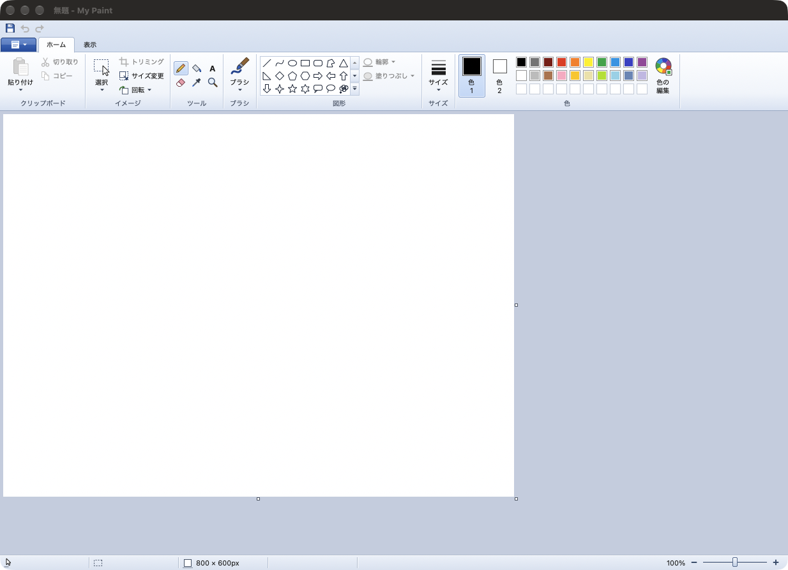

# My Paint

[Português (Brasil)](../../README.md) · [English](en.md) · [Español](es.md) · [Français](fr.md) · [Deutsch](de.md) · [Italiano](it.md) · **日本語** · [한국어](ko.md)

Windows 7 の「ペイント」を手本にした、macOS 用のシンプルな画像エディタです。画像を開き、鉛筆、ブラシ、図形、テキストで描いて、使い慣れたショートカットで PNG、JPEG、BMP、GIF に保存できます。

## macOS 版のダウンロード

- **[Apple シリコン（M シリーズ）用をダウンロード](https://github.com/leoars/my-paint/releases/download/0.1.1/My-Paint-0.1.1-arm64.pkg)**
- **[Intel 用をダウンロード](https://github.com/leoars/my-paint/releases/download/0.1.1/My-Paint-0.1.1-x86_64.pkg)**

macOS 12 以降に対応しています。 [最新版を見る](https://github.com/leoars/my-paint/releases/latest)



## このプロジェクトについて

My Paint は、My Notepad と同じ思いから生まれました。Windows から Mac に移ると、ウインドウとツールのリボン、白紙のキャンバスだけがあれば使える画像エディタが恋しくなります。このプロジェクトは、その使い心地を Swift と AppKit で、外部の依存なしに再現します。タイトルバーとメニューバーは macOS のもので、リボンから下はすべて Windows 7 のペイントにならっています。アイコン、テクスチャ、文言はすべて新たに描き起こし、書き起こしたものです。

## 日々の使い方

- **ツール：** 鉛筆、消しゴム、塗りつぶし、色の選択、拡大鏡、テキスト。左ボタンは「色 1」、右ボタンは「色 2」で描きます。
- **ブラシ：** ブラシ、カリグラフィ ブラシ 1 と 2、エアブラシ、油絵ブラシ、クレヨン、マーカー、色鉛筆、水彩ブラシ。それぞれに専用のサイズがあります。
- **図形：** ギャラリーの 23 種類すべて。直線や曲線から、矢印、星、吹き出し、ハート、稲妻まであります。「輪郭」と「塗りつぶし」（単色またはテクスチャ）を選び、ハンドルで調整して、外側をクリックすると確定します。`Shift` を押している間は縦横比や角度が保たれます。
- **選択：** 四角形または自由な形で選択でき、透明の選択、移動、複製、アプリ間のカット、コピー、ペーストに対応します。「トリミング」「サイズ変更と傾斜」「回転または反転」「色の反転」は、選択範囲にも画像全体にも使えます。
- **表示：** 12.5% から 800% までの拡大・縮小、ルーラー、グリッド線、全画面表示、縮小版、ステータスバー。
- **印刷、イメージのプロパティ、色の編集**（パレットに 10 個のカスタム枠）、最近使った画像、**デスクトップピクチャに設定**。
- **インターフェイスの文字サイズ**は 4 段階。高解像度ディスプレイ向けに、「表示」タブと **My Paint → 設定…** で変更できます。
- ポルトガル語、英語、スペイン語、フランス語、ドイツ語、イタリア語、日本語、韓国語に対応しています。


### 覚えておきたいショートカット

`Ctrl` を使うショートカットは Windows と同じように動作し、`Cmd` でも同じ操作ができます。

| キー | 操作 |
| --- | --- |
| `Ctrl+Z` · `Ctrl+Y` | 取り消しとやり直し（50 段階） |
| `Ctrl+A` · `Ctrl+C` · `Ctrl+X` · `Ctrl+V` | すべてを選択、コピー、カット、ペースト |
| `Ctrl+W` | サイズ変更と傾斜 |
| `Ctrl+Shift+X` · `Ctrl+Shift+I` | トリミングと色の反転 |
| `Ctrl++` / `Ctrl+-` | 線の太さを増減 |
| `Ctrl+B` · `Ctrl+I` · `Ctrl+U` | テキストの太字、斜体、下線 |
| `Ctrl+R` · `Ctrl+G` · `F11` | ルーラー、グリッド線、全画面表示 |
| `Ctrl+E` · `Ctrl+P` | イメージのプロパティと印刷 |
| `Shift+F10` | コンテキストメニュー |

## Mac でのビルドとインストール

ビルドには、Swift コンパイラを含む Apple の開発ツールを使います。プロジェクトのルートで次を実行します。

```sh
./build.sh
open "My Paint.app"
```

自動テストを実行するには：

```sh
./test.sh
```

2 種類のインストーラを作るには、次のコマンドを実行します。`dist/` で、Apple シリコンには `arm64`、Intel には `x86_64` のパッケージを選びます。`.pkg` ファイルを開くと、アプリが `/Applications` にインストールされます。

```sh
./package.sh
```

アイコンは `Tools/icon.swift` のコードで描かれます。作り直すには `swift Tools/icon.swift Resources/MyPaint.icns` を実行します。

## コントリビュート

ツール、リボン、ダイアログは [Swift](../../Sources) で実装し、テストは [Tests](../../Tests) にあります。[翻訳](../../Resources) は言語ごとの `.lproj` フォルダにあります。問題を報告するときは、macOS のバージョン、使っていたツール、可能であれば再現できる小さな画像を添えてください。

## ライセンス

本プロジェクト独自のコードと文書には [Apache License 2.0](../../LICENSE) が適用されます。Paint、Windows、Microsoft は Microsoft Corporation の商標であり、本プロジェクトは同社と関係ありません。[THIRD_PARTY_NOTICES.md](../../THIRD_PARTY_NOTICES.md) をご覧ください。
