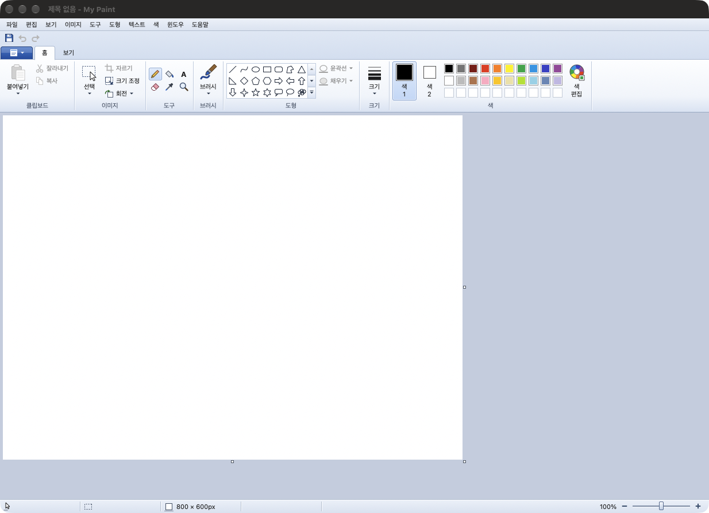

# My Paint

[Português (Brasil)](../../README.md) · [English](en.md) · [Español](es.md) · [Français](fr.md) · [Deutsch](de.md) · [Italiano](it.md) · [日本語](ja.md) · **한국어**

**My 스위트:** [My Explorer](https://github.com/leoars/my-explorer/blob/main/README.ko.md) · [My Notepad](https://github.com/leoars/My-Notepad/blob/main/docs/readme/ko.md) · **My Paint**

macOS용 간단한 이미지 편집기입니다. 이미지를 열고 연필, 브러시, 도형, 텍스트로 그린 뒤, 손에 익은 단축키로 PNG, JPEG, BMP, GIF로 저장하세요.

## macOS용 다운로드

- **[Apple Silicon(M 시리즈)용 다운로드](https://github.com/leoars/my-paint/releases/download/1.0/My-Paint-1.0-arm64.pkg)**
- **[Intel용 다운로드](https://github.com/leoars/my-paint/releases/download/1.0/My-Paint-1.0-x86_64.pkg)**

macOS 12 이상이 필요합니다. [최신 릴리스 보기](https://github.com/leoars/my-paint/releases/latest)



## 이 프로젝트를 만든 이유

My Paint는 My Notepad와 같은 생각에서 시작했습니다. 윈도우 하나와 도구 리본, 빈 캔버스만 있으면 되는 이미지 편집기입니다. 이 프로젝트는 그 작업 방식을 외부 의존성 없이 Swift와 AppKit으로 구현합니다. 아이콘, 질감, 문구는 모두 처음부터 새로 그리고 썼습니다.

## 기능

### 파일과 형식

- **새로 만들기**, **열기…**, **저장**, **다른 이름으로 저장…**, 그리고 **다른 형식으로 사본 저장**.
- PNG, JPEG, BMP, GIF, TIFF를 열고 저장합니다. Finder에서 이미지를 열 수 있습니다.
- **최근 그림**에는 파일이 9개까지 표시되며, 목록에 고정할 수 있습니다.
- **이미지 속성**: 크기, 단위(인치, 센티미터, 픽셀), 컬러 또는 흑백, 날짜, 디스크 할당 크기.
- **데스크탑 배경으로 설정**: 채우기, 바둑판식, 가운데.

### 도구

- **연필**, **지우개**, **색 채우기**, **색 선택**, **돋보기**, **텍스트**.
- 왼쪽 버튼은 색 1로, 오른쪽 버튼은 색 2로 그립니다.
- **크기**로 각 도구의 굵기를 정합니다.

### 브러시

- 브러시 9가지: 브러시, 캘리그래피 브러시 1과 2, 에어브러시, 유화 브러시, 크레용, 마커, 자연스러운 연필, 수채화 브러시. 브러시마다 크기가 네 가지입니다.

### 도형

- 갤러리의 도형 23가지: 선, 곡선, 타원, 사각형, 둥근 사각형, 다각형, 삼각형, 마름모, 오각형, 육각형, 화살표, 꼭짓점 4개·5개·6개 별, 말풍선, 하트, 번개.
- **윤곽선**과 **채우기**는 단색 또는 질감(크레용, 마커, 유화, 자연스러운 연필, 수채화)으로 지정합니다.
- 확정하기 전에 핸들로 도형을 조정할 수 있습니다. `Shift`를 누르고 있으면 비율이나 각도가 유지됩니다.


### 색

- **색 1**과 **색 2**, 20색 팔레트와 사용자 지정 색을 위한 칸 10개.
- **색 편집**: 기본 색 48개, 사용자 지정 색 16개, 그리고 색상·채도·명도 또는 빨강·녹색·파랑으로 조정.
- 흑백 모드에서는 팔레트와 그림이 두 가지 색만 사용합니다.

### 선택과 클립보드

- **사각형 선택**, **자유형 선택**, **모두 선택**, **선택 영역 반전**, **투명하게 선택**.
- 이동, 복제(`Ctrl`을 누른 채 드래그), 핸들로 늘이기, 화살표 키로 한 픽셀씩 옮기기가 가능합니다.
- 앱 간 **잘라내기**, **복사**, **붙여넣기**와 파일을 가져오는 **파일에서 붙이기…**.

### 이미지

- 선택 영역으로 **자르기**.
- **크기 조정 및 기울이기**는 백분율 또는 픽셀 기준이며, 가로 세로 비율 유지 여부를 고를 수 있습니다.
- 오른쪽 또는 왼쪽으로 90°, 그리고 180° **회전**, 상하 또는 좌우 대칭.
- **색 반전**.
- 모두 선택 영역이나 이미지 전체에 적용됩니다. 캔버스 크기도 핸들로 조정할 수 있습니다.

### 텍스트

- **텍스트 도구** 탭에서 글꼴 이름, 글꼴 크기, 굵게, 기울임꼴, 밑줄, 취소선을 지정합니다.
- 배경은 불투명 또는 투명.
- 일본어와 한국어 입력기를 지원합니다.

### 보기

- 12.5%에서 800%까지 확대/축소하며, 키보드나 상태 표시줄의 슬라이더로 조절합니다.
- **눈금자**, **눈금선**, **상태 표시줄**, **전체 화면**, **미리 보기**.
- **인터페이스 텍스트 크기**는 네 단계이며, 고해상도 디스플레이를 위해 보기 탭과 **My Paint → 설정…**에서 바꿀 수 있습니다.

### 인쇄

- **프린트…**, **페이지 설정…**(지정한 페이지 수에 맞춤, 가운데 맞춤), **인쇄 미리 보기**.

### 인터페이스와 언어

- macOS 메뉴 막대 외에, 윈도우 안 리본 위에도 메뉴가 있습니다.
- **홈** 탭과 **보기** 탭이 있는 리본(최소화 가능)과 저장, 실행 취소, 다시 실행이 있는 빠른 실행 도구 모음.
- 실행 취소와 다시 실행은 50단계.
- 포르투갈어, 영어, 스페인어, 프랑스어, 독일어, 이탈리아어, 일본어, 한국어를 지원합니다.

### 단축키

`Ctrl` 단축키는 익숙한 방식 그대로 동작하며, `Cmd`로도 같은 동작을 할 수 있습니다.

| 키 | 동작 |
| --- | --- |
| `Ctrl+N` · `Ctrl+O` · `Ctrl+S` · `F12` | 새로 만들기, 열기, 저장, 다른 이름으로 저장 |
| `Ctrl+Z` · `Ctrl+Y` | 실행 취소와 다시 실행(50단계) |
| `Ctrl+A` · `Ctrl+C` · `Ctrl+X` · `Ctrl+V` | 모두 선택, 복사, 잘라내기, 붙여넣기 |
| `Ctrl+W` | 크기 조정 및 기울이기 |
| `Ctrl+Shift+X` · `Ctrl+Shift+I` | 자르기와 색 반전 |
| `Ctrl++` / `Ctrl+-` | 선 굵기 늘리기 또는 줄이기 |
| `Ctrl+Page Up` / `Ctrl+Page Down` | 확대 또는 축소 |
| `Ctrl+B` · `Ctrl+I` · `Ctrl+U` | 텍스트의 굵게, 기울임꼴, 밑줄 |
| `Ctrl+R` · `Ctrl+G` · `F11` | 눈금자, 눈금선, 전체 화면 |
| `Ctrl+E` · `Ctrl+P` | 이미지 속성과 인쇄 |
| `Ctrl+F1` | 리본 최소화 |
| `Shift+F10` | 컨텍스트 메뉴 |
| `Esc` · `Enter` · `Delete` | 동작 취소, 도형 확정, 선택 영역 삭제 |

## My 스위트의 일부

My Paint는 My 스위트에 속합니다. My 스위트는 익숙한 메뉴와 단축키를 갖춘, 간단하고 직관적인 macOS용 앱 세 가지입니다.

- **My Paint**(이 저장소): 간단한 이미지 편집기.
- **[My Explorer](https://github.com/leoars/my-explorer/blob/main/README.ko.md)**: 폴더 트리, 탭, 명령 모음을 갖춘 파일 관리자. My Paint가 설치되어 있으면 My Explorer의 컨텍스트 메뉴에 이미지용 **My Paint로 편집**이 추가됩니다.
- **[My Notepad](https://github.com/leoars/My-Notepad/blob/main/docs/readme/ko.md)**: 간단한 텍스트 편집기.

## Mac에서 빌드하고 설치하기

빌드하려면 Swift 컴파일러가 포함된 Apple 개발 도구가 필요합니다. 프로젝트 루트에서 다음을 실행하세요.

```sh
./build.sh
open "My Paint.app"
```

자동 테스트를 실행하려면:

```sh
./test.sh
```

두 가지 설치 프로그램을 만들려면 아래 명령을 실행하세요. `dist/`에서 Apple Silicon에는 `arm64`, Intel에는 `x86_64` 패키지를 고릅니다. `.pkg` 파일을 열면 앱이 `/Applications`에 설치됩니다.

```sh
./package.sh
```

아이콘은 `Tools/icon.swift`의 코드로 그립니다. 다시 만들려면 `swift Tools/icon.swift Resources/MyPaint.icns`를 실행하세요.

## 기여하기

도구, 리본, 대화 상자는 [Swift](../../Sources)로 작성했고, 테스트는 [Tests](../../Tests)에 있습니다. [번역](../../Resources)은 언어별 `.lproj` 폴더에 있습니다. 문제를 알릴 때는 macOS 버전, 사용한 도구, 그리고 가능하면 문제를 재현하는 작은 이미지를 함께 보내 주세요.

## 라이선스

이 프로젝트의 고유한 코드와 문서는 [Apache License 2.0](../../LICENSE)에 따라 배포됩니다. [THIRD_PARTY_NOTICES.md](../../THIRD_PARTY_NOTICES.md)를 참고하세요.
